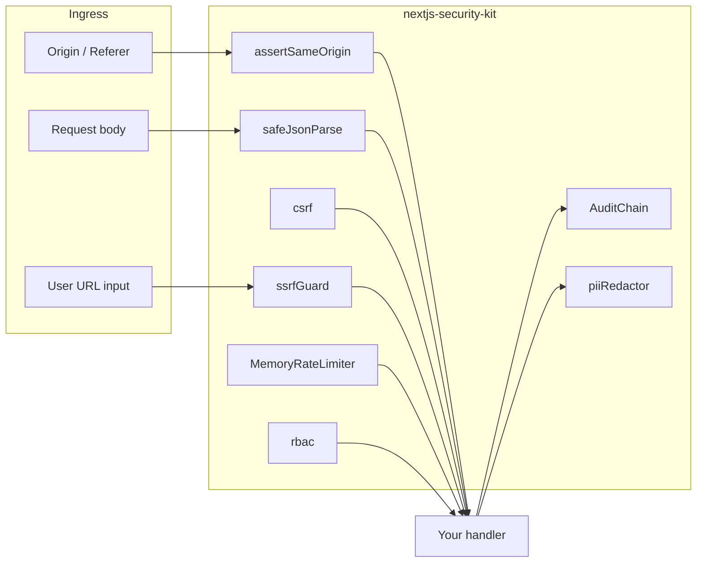

# nextjs-security-kit

Small, dependency-free security helpers you can drop into Next.js route handlers, server actions, or any Node HTTP stack. Every module is pure TypeScript with no Next.js runtime required for unit tests.

## What it is for

- **CSRF** — session-bound HMAC tokens for mutating requests
- **Same-origin checks** — validate `Origin` / `Referer` against an allowlist
- **SSRF guard** — block private IPs, link-local, and cloud metadata hosts before `fetch`
- **Rate limiting** — in-memory sliding window for development and single-instance deploys
- **Safe JSON** — parse request bodies with a byte-size ceiling
- **CSV escape** — export user data without formula injection surprises
- **Audit chain** — append-only hash chain for tamper-evident logs
- **RBAC** — simple `admin` / `editor` / `viewer` permission checks
- **PII redaction** — strip emails and phone-like strings from logs

## Demo

```ts
import {
  createToken,
  verifyToken,
  assertSameOrigin,
  ssrfGuard,
  MemoryRateLimiter,
  safeJsonParse,
  AuditChain,
  can,
  redactPii,
} from "nextjs-security-kit";

const csrf = createToken(process.env.CSRF_SECRET!, sessionId);
const originOk = assertSameOrigin(request.headers, ["https://app.example.com"]);
const outbound = ssrfGuard(userSuppliedUrl);
const body = safeJsonParse(await request.text(), { maxBytes: 65_536 });

const limiter = new MemoryRateLimiter({ windowMs: 60_000, max: 100 });
const { allowed } = limiter.consume(clientIp);

const audit = new AuditChain();
audit.append(JSON.stringify({ action: "login", userId }));

if (can(role, "content:publish")) {
  // ...
}

console.log(redactPii(logLine));
```

## Quick start

```bash
npm install
make verify
```

`make verify` runs `npm ci` (when lockfile present) and `npm run verify` (`tsc --noEmit` + Vitest).

## Architecture



## Decisions and tradeoffs

| Choice | Why | Cost |
|--------|-----|------|
| In-memory rate limiter | Zero deps, easy to test | Not shared across serverless instances — use Redis in production |
| HMAC CSRF tokens | No server-side token store | Requires stable `sessionId` and secret rotation discipline |
| Hostname-only SSRF guard | Fast, pure parsing | Does not resolve DNS; combine with egress proxies for high risk |
| Hash-chain audit log | Tamper evidence without a blockchain | Integrity only if you persist `lastHash` externally |
| Regex PII redaction | Cheap log hygiene | Not a full DLP scanner |

## Tests

```bash
npm test
```

Vitest covers happy paths and failure modes for every module under `tests/`.

## License

MIT — see [LICENSE](./LICENSE).

## Hire note

If you want this level of defensive defaults wired through your Next.js app (auth, webhooks, admin APIs, export pipelines), reach out via the GitHub profile linked from this repository.
